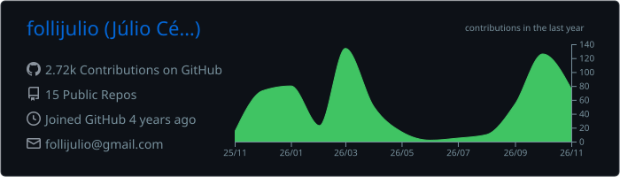
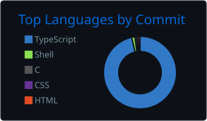

<!--
  FOLLIJULIO — GITHUB PROFILE
  Design: Technical Editorial / Brutalist Minimalism
  Repository: https://github.com/follijulio
-->

<div align="center">

# `follijulio`

**JÚLIO CÉSAR DA SILVA FOLLI**

*Software Developer · Mathematics Student · Technology Enthusiast*

<br/>

`building things` · `breaking limits` · `collecting federal universities`

<br/>

<a href="https://portifolli.follijulio.online/">
  
</a>
<a href="https://github.com/follijulio">
  
</a>
<a href="https://leetcode.com/">
  
</a>

<br/><br/>

</div>

---

## `01` — ABOUT

```typescript
const julio = {
  name: "Júlio César da Silva Folli",
  username: "follijulio",
  location: "Brazil",

  education: {
    university: "UFAL",
    degree: "BSc Mathematics",
    technical: "IFAL — IT Technician"
  },

  interests: [
    "Software Engineering",
    "Frontend Development",
    "Computer Science",
    "Mathematics",
    "Open Source"
  ],

  philosophy: "Understand deeply. Build deliberately."
};
```

I'm a developer with a technical background in Information Technology and an academic journey through Mathematics at the Federal University of Alagoas (UFAL).

Interested in the intersection between logical reasoning, software engineering and interface design. I enjoy building applications, exploring technologies and turning ideas into functional products.

Currently studying Mathematics, developing software and working towards the next chapter in Computer Science.

---

## `02` — DEVELOPMENT ENVIRONMENT

<details open>
<summary><b>System configuration · ~/.env</b></summary>

```ini
# ─────────────────────────────────────────
# SYSTEM
# ─────────────────────────────────────────

OS=Arch Linux
WM=Hyprland
TERMINAL=Kitty
SHELL=Bash / Zsh

# ─────────────────────────────────────────
# DEVELOPMENT
# ─────────────────────────────────────────

LANGUAGES=JavaScript, TypeScript, C, Go
FRAMEWORKS=React, Next.js
STYLING=Tailwind CSS
RUNTIME=Node.js
VERSION_CONTROL=Git
PLATFORM=GitHub

# ─────────────────────────────────────────
# WORKFLOW
# ─────────────────────────────────────────

EDITOR=Code Editor
PHILOSOPHY=Minimalism
FOCUS=Engineering & Mathematics
```

</details>

**Core technologies**

<p>
  
</p>

---

## `03` — FEATURED WORKS

Selected projects, experiments and digital products.

### [`01` — PORTIFOLLI](https://portifolli.follijulio.online/)

**Personal Portfolio**

My central digital space. A presentation of my work, technical background, projects and development journey.

`PORTFOLIO` `WEB DEVELOPMENT`

---

### [`02` — JUNO](https://www.estantejuno.online/)

**Personal Digital Library**

A digital bookshelf designed to organize books, manage reading progress and centralize a personal reading collection.

`NEXT.JS` `REACT` `OPEN LIBRARY`

---

### [`03` — MULTI](https://multi.follijulio.online/pt/)

**Multi — Digital Project**

A web-based project developed as part of my exploration of software engineering, application architecture and user experience.

`WEB APPLICATION` `DEVELOPMENT`

---

### [`04` — NYX](https://follijulio.github.io/nyx/)

**NYX — Web Experiment**

An independent project hosted through GitHub Pages, representing my experiments with frontend development and digital interfaces.

`GITHUB PAGES` `FRONTEND`

---

<div align="center">

**MORE PROJECTS**

[Explore all repositories →](https://github.com/follijulio?tab=repositories)

</div>

---


## `04` — GITHUB ANALYTICS

<div align="center">

### Contribution Overview



<br/>

### Development Statistics


<br/>

### Language Distribution




</div>

---


## `05` — ACADEMIC BACKGROUND

**UFAL — Federal University of Alagoas**

`UNDERGRADUATE STUDENT`

Bachelor's degree studies in Mathematics. Developing analytical thinking, mathematical reasoning and problem-solving skills.

**IFAL — Federal Institute of Alagoas**

`TECHNICAL EDUCATION`

Technical qualification in Information Technology, establishing my foundation in programming, computing and software development.

---

## `06` — CONNECT

Open to technical discussions, collaborations, interesting projects and knowledge exchange.

<div align="center">

<a href="mailto:SEU_EMAIL">
  
</a>
<a href="https://www.linkedin.com/in/SEU_USUARIO/">
  
</a>
<a href="https://github.com/follijulio">
  
</a>
<a href="https://lattes.cnpq.br/SEU_ID">
  
</a>
<a href="https://leetcode.com/SEU_USUARIO/">
  
</a>

</div>

---

<div align="center">

```text
┌──────────────────────────────────────────────┐
│                                              │
│   THINK MATHEMATICALLY.                      │
│   BUILD COMPUTATIONALLY.                     │
│   CREATE INTENTIONALLY.                      │
│                                              │
└──────────────────────────────────────────────┘
```

**`follijulio`** · Made with logic and curiosity.

<sub>© Júlio César da Silva Folli · 2026</sub>

</div>
