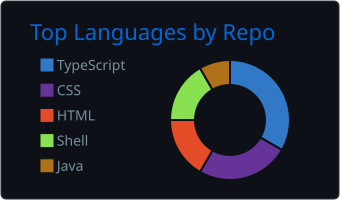
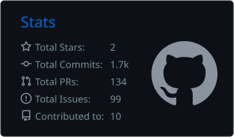

# `follijulio`

**Júlio César da Silva Folli**

`Software Developer` · `Mathematics Student` · `Brazil`

Building software, exploring mathematics and collecting federal universities.

[Portfolio](https://portifolli.follijulio.online/) · [Projects](https://github.com/follijulio?tab=repositories) · [LinkedIn](https://www.linkedin.com/) · [Email](mailto:SEU_EMAIL)

---

## `01` — ABOUT

Software developer with a technical background in Information Technology (IFAL) and currently studying Mathematics at the Federal University of Alagoas (UFAL).

Interested in software engineering, frontend development, problem-solving and the intersection between mathematics and computing.

## `02` — ENVIRONMENT

```ini
OS        = Arch Linux
WM        = Hyprland
TERMINAL  = Kitty
SHELL     = Bash / Zsh

LANGUAGES = JavaScript, TypeScript, C, Go
STACK     = React, Next.js, Tailwind CSS
TOOLS     = Git, GitHub, Node.js
```

<p align="center">
  
</p>

---

## `03` — FEATURED PROJECTS

**[Portifolli ↗](https://portifolli.follijulio.online/)** — Personal portfolio and development showcase.

**[Juno ↗](https://www.estantejuno.online/)** — Digital bookshelf and personal reading manager.

**[Multi ↗](https://multi.follijulio.online/pt/)** — Digital application and web development project.

**[Nyx ↗](https://follijulio.github.io/nyx/)** — Frontend experiment hosted on GitHub Pages.

[Explore all repositories →](https://github.com/follijulio?tab=repositories)

---

## `04` — GITHUB ANALYTICS

<div align="center">






</div>

---

## `05` — EDUCATION

**UFAL** — Mathematics · Undergraduate

**IFAL** — Technical Degree in Information Technology

---

## `06` — CONTACT

[Email](mailto:SEU_EMAIL) · [LinkedIn](https://www.linkedin.com/in/SEU_USUARIO/) · [GitHub](https://github.com/follijulio) · [Lattes](https://lattes.cnpq.br/SEU_ID) · [LeetCode](https://leetcode.com/SEU_USUARIO/)

---

<div align="center">

```text
THINK MATHEMATICALLY.
BUILD COMPUTATIONALLY.
CREATE INTENTIONALLY.
```

<sub>© 2026 · Júlio César da Silva Folli</sub>

</div>
